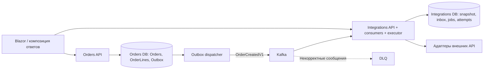
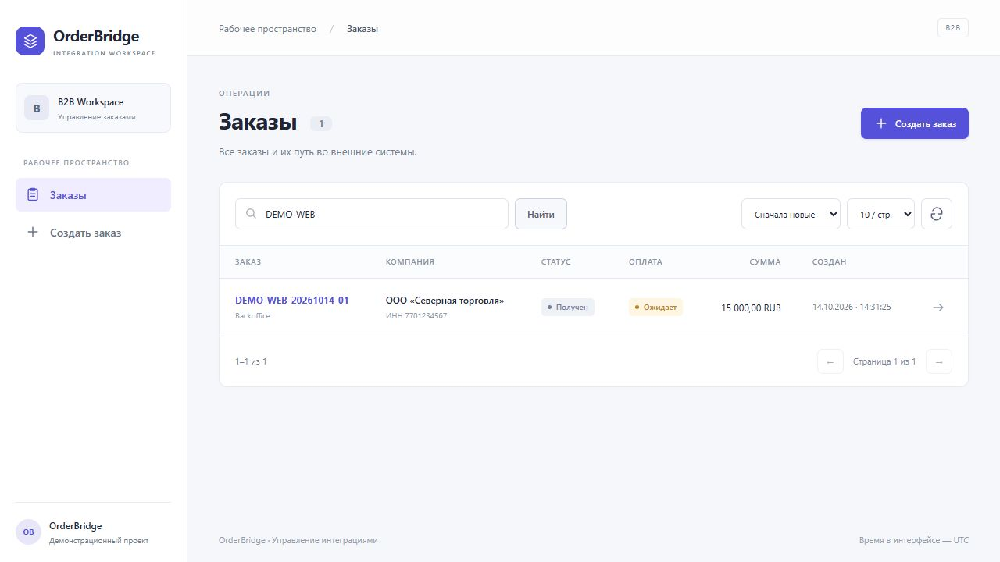
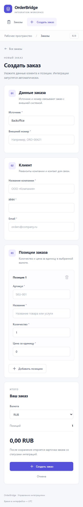
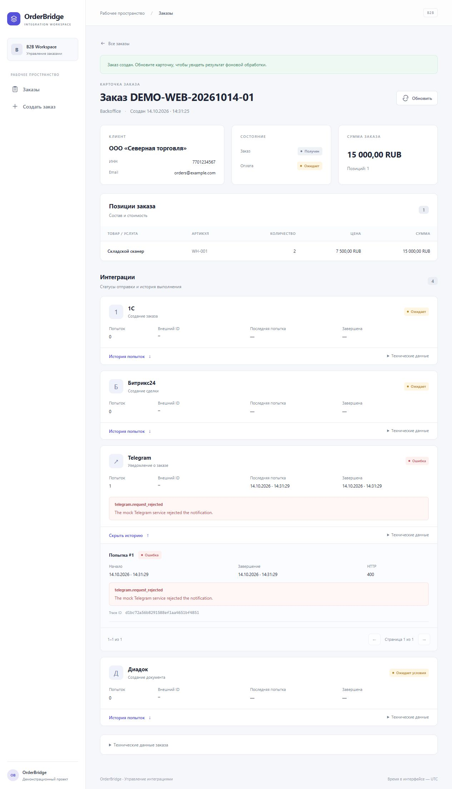

# OrderBridge

Демонстрационная B2B-система на .NET 10: приём заказов, асинхронное планирование
и выполнение интеграций, аудит попыток и интерфейс оператора на Blazor.

Общие события, Kafka, outbox/inbox и примеры подключения: [Messaging](docs/messaging.md).

Подробный разбор текущего кода: [архитектура, сообщения, диаграммы и поведение при сбоях](docs/architecture.md).

## Структура репозитория

```text
B2BOrderBridge/
├── B2BOrderBridge.slnx                 # Всё решение, проекты сгруппированы по сервисам
├── docker-compose.yml
├── src/
│   ├── Services/
│   │   ├── Orders/
│   │   │   ├── Orders.slnx            # Самостоятельная сборка Orders
│   │   │   ├── OrderBridge.Orders.Domain/
│   │   │   ├── OrderBridge.Orders.Application/
│   │   │   ├── OrderBridge.Orders.Infrastructure/
│   │   │   └── OrderBridge.Orders.Api/
│   │   └── Integrations/
│   │       ├── Integrations.slnx      # Самостоятельная сборка Integrations
│   │       ├── OrderBridge.Integrations.Domain/
│   │       ├── OrderBridge.Integrations.Application/
│   │       ├── OrderBridge.Integrations.Infrastructure/
│   │       └── OrderBridge.Integrations.Api/
│   ├── Contracts/OrderBridge.Contracts/
│   ├── BuildingBlocks/
│   │   ├── Shared.Domain/             # Entity, AggregateRoot, Guard, общие исключения
│   │   ├── Shared.Messaging.Abstractions/ # Конверт, метаданные и интерфейсы
│   │   ├── Shared.Messaging.Kafka/        # Общий транспорт и подписки
│   │   ├── Shared.Messaging.Persistence/  # Общие PostgreSQL outbox/inbox
│   │   └── Shared.Application/        # Result, CQRS, validation, pagination, базовые интерфейсы
│   └── Web/OrderBridge.Web/
├── tests/
│   ├── Services/Orders/
│   ├── Services/Integrations/
│   ├── BuildingBlocks/
│   └── Web/
└── tools/Import-LegacyDatabase.ps1
```

## Запуск

Нужен Docker Desktop с Linux-контейнерами. Из корня репозитория:

```powershell
docker compose -f B2BOrderBridge/docker-compose.yml up -d --build
```

| Компонент | Адрес |
|---|---|
| Blazor | http://localhost:8090 |
| Orders API / Swagger | http://localhost:8088/swagger |
| Integrations API / Swagger | http://localhost:8089/swagger |
| Orders PostgreSQL | localhost:5433, БД/пользователь `orders` |
| Integrations PostgreSQL | localhost:5434, БД/пользователь `integrations` |
| Kafka | localhost:9092; внутри Compose `kafka:19092` |

Миграции двух сервисов применяются их API при старте в Compose. Для production
их нужно запускать отдельным шагом развёртывания. Данные каждой БД и Kafka хранятся
в отдельных volumes. Новая установка не содержит автоматически созданных заказов.
Локальные пароли: `orders_dev` / `integrations_dev`; переопределяются через
`ORDERS_DB_PASSWORD` / `INTEGRATIONS_DB_PASSWORD`.
Порты настраиваются переменными `WEB_PORT`, `ORDERS_API_PORT`, `INTEGRATIONS_API_PORT`,
`ORDERS_DB_PORT`, `INTEGRATIONS_DB_PORT`, `KAFKA_PORT`.

## Границы сервисов

**Orders** владеет заказом, позициями, реквизитами клиента, состоянием оплаты и outbox.
Его Domain, Application, Infrastructure, DbContext и миграции находятся внутри `Services/Orders`.

**Integrations** владеет планами интеграций, попытками, inbox и локальной проекцией заказа.
Снимок заказа приходит из события Kafka и сохраняется в `IntegrationOrders`.
Исполнитель читает этот снимок из собственной БД. У сервиса нет подключения к Orders DB
и нет HTTP-запросов к Orders API для выполнения интеграции.

Сервисы не ссылаются на проекты друг друга. У них отдельные PostgreSQL-контейнеры,
пользователи, схемы миграций, volumes и сети доступа к данным. Каждый Dockerfile
копирует исходники только своего сервиса и общие контракты/BuildingBlocks.
В общих библиотеках нет доменных сущностей Orders или Integrations.



`GET /api/orders/{id}/details` возвращает только данные, принадлежащие Orders.
Интеграции и попытки доступны через `/api/order-integrations` на Integrations API.
Blazor объединяет ответы двух API на своём сервере. При недоступности Integrations
заказ остаётся доступен, а вместо статусов отображается сообщение о недоступности.
Обновление выполняется вручную. Время в интерфейсе — UTC.

## Сценарий и надёжность

1. Order.CreateOrder поднимает OrderCreatedDomainEvent. CreateOrderCommandHandler явно вызывает
   доменный dispatcher: Application-handler добавляет OrderCreatedV1 в outbox. Затем UnitOfWork
   сохраняет заказ с outbox, а команда очищает доменные события.
2. Outbox dispatcher публикует событие с ключом `OrderId`, сохраняя исходный `EventId`.
3. Consumer Integrations атомарно сохраняет inbox-отметку, локальный снимок и план интеграций.
4. Kafka offset подтверждается после коммита этой транзакции.
5. Исполнитель раз в 10 секунд выбирает доступные задачи и выполняет адаптеры
   с ограничением параллелизма и отдельными DI scopes.
6. Результат и история каждой попытки доступны в карточке заказа.

Доставка событий — **at least once**. Сбой после подтверждения публикации, но до
отметки outbox может вызвать повтор. Inbox защищает от одинакового `EventId` и повторного `IdempotencyKey` обработчика,
а уникальность пары заказа / Target / Operation и проверка существующего плана
предотвращают создание повторных интеграций при повторно обёрнутом событии.
Локальный снимок создания заказа не перезаписывается повторной доставкой.

При недоступной Kafka Orders продолжает принимать заказы; события остаются в outbox
и повторно публикуются после восстановления. Несколько издателей используют
`FOR UPDATE SKIP LOCKED`. При сбое БД consumer не подтверждает offset и повторяет обработку.
Неправильный JSON, неизвестный сценарий и несовпадающий Kafka key направляются в DLQ;
offset подтверждается только после подтверждения публикации в DLQ.

Повторы событий в outbox/inbox и повторы внешних вызовов — разные механизмы.
Временный сбой адаптера планирует retry согласно политике, постоянный переводит задачу
в Failed. История попыток создаётся при фактическом запуске, а не заранее.

Telegram пока использует mock, случайно возвращающий успех, HTTP 503 или HTTP 400.
Битрикс24 и 1С запланированы, но обработчики ещё не зарегистрированы.
Диадок ожидает предварительного условия. RabbitMQ и отдельные сервисы адаптеров
пока не добавлены. События изменения/отмены заказа и синхронизация последующих
изменений снимка — следующий функциональный этап.

Kafka в Compose — single-node KRaft без ZooKeeper, три partitions на топик,
replication factor 1 и retention 7 дней. Это локальная конфигурация без HA/TLS/SASL.
Очистка outbox/inbox и повторная отправка DLQ пока не автоматизированы. Inbox нельзя
удалять раньше допустимого окна повторного воспроизведения событий.

## Разработка и проверки

Требуется .NET SDK 10. Из `B2BOrderBridge`:

```powershell
dotnet build B2BOrderBridge.slnx
dotnet test B2BOrderBridge.slnx

# Независимые сборки:
dotnet build src/Services/Orders/Orders.slnx
dotnet build src/Services/Integrations/Integrations.slnx

# Отдельный запуск, если соответствующий контейнер API остановлен:
$env:Persistence__ApplyMigrationsOnStartup = 'true'
dotnet run --project src/Services/Orders/OrderBridge.Orders.Api
# В другом терминале:
dotnet run --project src/Services/Integrations/OrderBridge.Integrations.Api
```

Адреса БД задаются через `ConnectionStrings__Orders` и `ConnectionStrings__Integrations`.
Брокер — `Kafka__BootstrapServers`. Web использует `OrdersApi__BaseUrl` и
`IntegrationsApi__BaseUrl`. У него нет ссылок на backend-проекты и доступа к БД.

Тесты каждого сервиса используют свой PostgreSQL Testcontainer и не требуют БД
другого сервиса. Проверяются доменные переходы, валидация, чтение/пагинация,
атомарность outbox/inbox, конкурентные повторы, локальное выполнение и журнал попыток.
Отдельный архитектурный тест запрещает межсервисные ProjectReference.
Web-тесты проверяют композицию двух API и частичную доступность.

Оба API предоставляют `/health/live` и `/health/ready`. Логи:

```powershell
docker compose logs -f orders-api integrations-api
docker compose exec kafka /opt/kafka/bin/kafka-consumer-groups.sh --bootstrap-server kafka:19092 --group orderbridge-integration-planner-v1 --describe
```

## Переход со старой общей БД

Миграции теперь независимые; старый volume `order-bridge-postgres-data` не удаляется.
Перед первым запуском новых API можно перенести прежние данные (из `B2BOrderBridge`):

1. Остановить отладку старого приложения и контейнеры `order-bridge-api` /
   `order-bridge-integration-worker-1`. Старый `order-bridge-postgres` должен быть запущен.
2. Поднять только новые базы и Kafka:

```powershell
docker compose up -d orders-db integrations-db kafka
dotnet ef database update --project src/Services/Orders/OrderBridge.Orders.Infrastructure --startup-project src/Services/Orders/OrderBridge.Orders.Infrastructure
dotnet ef database update --project src/Services/Integrations/OrderBridge.Integrations.Infrastructure --startup-project src/Services/Integrations/OrderBridge.Integrations.Infrastructure
./tools/Import-LegacyDatabase.ps1
docker compose up -d --build
```

Скрипт читает старую БД, переносит заказы/outbox в Orders и снимки/интеграции/попытки/inbox
в Integrations. ID и ключи идемпотентности сохраняются. Вставки не перезаписывают существующие
строки, импорт каждой целевой БД выполняется в отдельной транзакции. Запускать до обработки
новых заказов; это инструмент перехода с прежней схемы, а не постоянная синхронизация.
После сверки исходный контейнер можно остановить; volume остаётся резервной копией.
Старые миграции общей схемы к новым БД не применяются.

## Интерфейс




