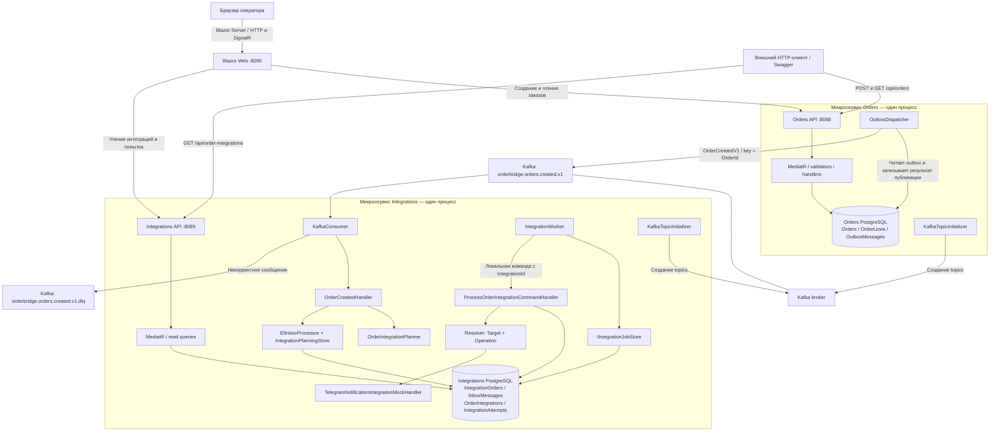
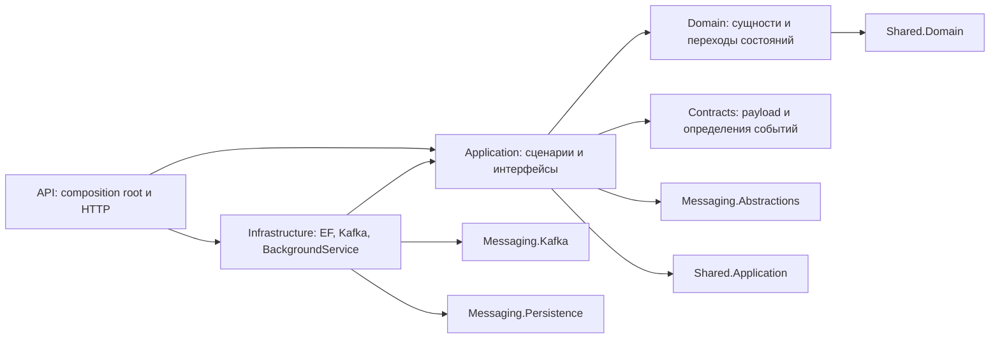
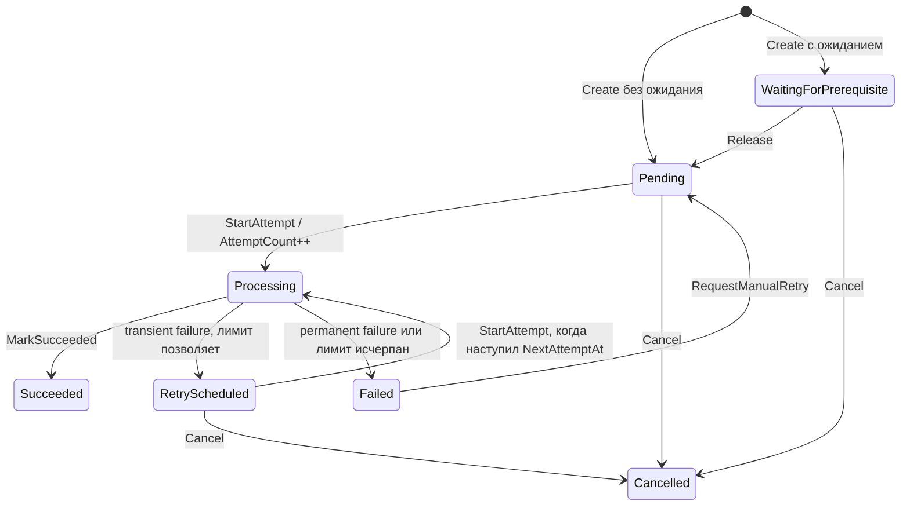
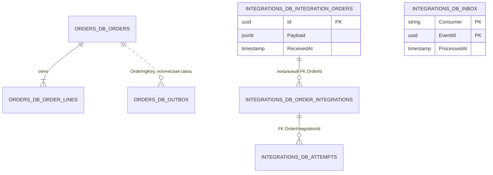
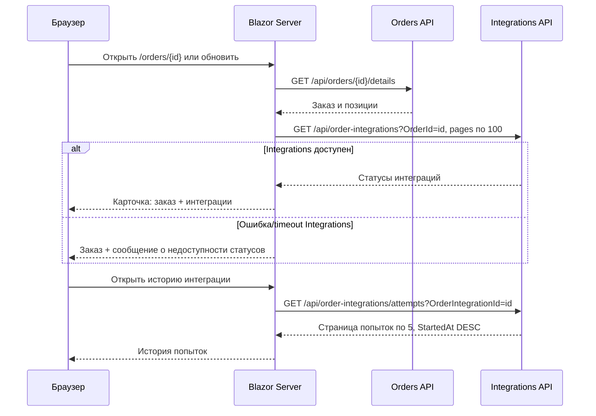

# Как работает OrderBridge

Документ описывает код после разделения Orders и Integrations, по состоянию на 20.10.2026.
Пунктирные связи и отдельные примечания обозначают предусмотренные расширения, которые ещё не работают.
Диаграммы написаны на Mermaid и отображаются в GitHub. Их исходники находятся прямо в этом файле.
Подключение общих библиотек и примеры кода: [Messaging](messaging.md).

## 1. Какие процессы запущены

У системы два backend-микросервиса и отдельный Blazor Server. Каждый backend имеет собственные
Domain, Application, Infrastructure, API, PostgreSQL и миграции. Kafka связывает сервисы.



**Что здесь не является отдельным микросервисом:** OutboxDispatcher, consumer, planner, worker
и Telegram mock — это классы внутри двух API-процессов. При остановке `integrations-api`
останавливаются одновременно его HTTP API, Kafka consumer и исполнитель задач.

Отдельных сервисов Bitrix24/1С/Диадок/Telegram сейчас нет. RabbitMQ нет.
Конкретные задания интеграций хранятся в PostgreSQL, а не в отдельных Kafka topics.

## 2. Навигация по исходникам и зависимости слоёв

Относительные пути в этом документе считаются от `B2BOrderBridge/`, кроме ссылок Markdown.

```text
src/
  Services/
    Orders/
      Orders.slnx
      OrderBridge.Orders.Domain/
      OrderBridge.Orders.Application/
      OrderBridge.Orders.Infrastructure/
      OrderBridge.Orders.Api/
    Integrations/
      Integrations.slnx
      OrderBridge.Integrations.Domain/
      OrderBridge.Integrations.Application/
      OrderBridge.Integrations.Infrastructure/
      OrderBridge.Integrations.Api/
  Contracts/OrderBridge.Contracts/
  BuildingBlocks/Shared.Domain/
  BuildingBlocks/Shared.Application/
  BuildingBlocks/Shared.Messaging.Abstractions/
  BuildingBlocks/Shared.Messaging.Kafka/
  BuildingBlocks/Shared.Messaging.Persistence/
  Web/OrderBridge.Web/
tests/
  Services/Orders/
  Services/Integrations/
  BuildingBlocks/
  Web/
```

Внутри каждого сервиса направления ссылок на проекты одинаковые:



Infrastructure реализует интерфейсы Application; интерфейсы регистрируются в DI.
Application использует IUnitOfWork. В Orders это OrdersUnitOfWork, который сохраняет
tracked-изменения OrdersDbContext; в Integrations — его DbContext. Доменный dispatcher
вызывается явно в Application перед сохранением, UnitOfWork его не запускает.
API собирает зависимости в `Program.cs`, вызывая `AddApplication`, `AddPersistence`, `AddMessaging`.

| Проект/слой | Что в нём находится |
|---|---|
| Orders.Domain | `Order`, `OrderLine`, `CustomerSnapshot`, валюты, статусы заказа и оплаты, доменные события |
| Orders.Application | Команда создания, запросы чтения, валидаторы, DTO, доменный обработчик OrderCreated → outbox |
| Orders.Infrastructure | OrdersUnitOfWork, OrdersDbContext, репозитории, миграции и регистрация общих outbox/Kafka |
| Orders.Api | HTTP-контроллер, запросы API, преобразование Result в HTTP, обработка validation errors, health/Swagger |
| Integrations.Domain | `OrderIntegration`, Target/Operation/Status, правила переходов состояний |
| Integrations.Application | Планирование, выполнение, resolver, retry policy, `IntegrationAttempt`, запросы аудита, snapshot и интерфейсы хранилищ |
| Integrations.Infrastructure | Собственная БД, регистрация общего inbox/consumer, сохранение плана, выборка заданий, worker |
| Integrations.Api | Чтение статусов и попыток через HTTP, health/Swagger, composition root |
| Contracts | Payload и определения маршрутов/версий событий: `OrderCreatedV1`, `OrderSnapshotV1`, `CustomerSnapshotV1`, `OrderLineV1` |
| Shared.Domain | Базовые Entity/AggregateRoot, Guard, доменные абстракции |
| Shared.Application | Result/Error, CQRS-контракты поверх MediatR, validation behaviour, pagination, общие интерфейсы |
| Shared.Messaging.Abstractions | IntegrationEvent, метаданные, определения событий и интерфейсы |
| Shared.Messaging.Kafka | Универсальные producer/consumer, сериализация, подписки, scopes, offsets, DLQ |
| Shared.Messaging.Persistence | Универсальные PostgreSQL outbox/inbox, EF-модель и транзакционная обработка |
| Web | Собственные модели представления, HTTP-клиенты, страницы; без ссылок на backend-проекты |

У сервисов нет ProjectReference друг на друга и нет общего бизнес-домена. Общие Contracts
связывают их форматом сообщения, поэтому изменение wire-контракта требует совместимости.
Telegram mock пока расположен в Application и зарегистрирован там — это фактическое текущее размещение.

## 3. Полный путь создания заказа

```mermaid
sequenceDiagram
    autonumber
    participant C as HTTP-клиент / Blazor
    participant A as Orders API
    participant H as CreateOrderCommandHandler
    participant U as OrdersUnitOfWork
    participant E as Domain event handler
    participant D as Orders DB
    participant O as OutboxDispatcher
    participant K as Kafka
    participant R as KafkaConsumer
    participant P as Inbox / Handler / Planner / Store
    participant I as Integrations DB
    C->>A: POST /api/orders
    A->>H: MediatR.Send(CreateOrderCommand), после validation
    H->>H: Order.CreateOrder создаёт OrderCreatedDomainEvent
    H->>E: Явный DispatchAsync доменного события
    E->>E: Map в IntegrationEvent, добавить в tracked outbox
    E-->>H: Обработано в памяти, БД ещё не сохранена
    H->>U: IUnitOfWork.SaveChangesAsync
    U->>D: SaveChanges: Order + Lines + OutboxMessage; COMMIT
    U-->>H: Успех
    H->>H: order.ClearDomainEvents()
    H-->>A: Result<CreateOrderResponse>
    A-->>C: 201 Created + DTO + Location
    Note over C,I: 201 подтверждает сохранение заказа, но не завершение интеграций
    O->>D: BEGIN, SELECT 1 due outbox FOR UPDATE SKIP LOCKED
    O->>K: Publish OrderCreatedV1, key = OrderId
    K-->>O: Подтверждение публикации
    O->>D: PublishedAt, PublishAttempts; COMMIT
    K->>R: Запись topic: key + JSON + partition/offset
    R->>R: Проверить JSON, metadata, тип/версию и record key
    R->>P: Inbox.ProcessAsync, затем Handler.HandleAsync(envelope)
    P->>I: BEGIN; INSERT inbox с envelope
    alt Новое событие
        P->>P: Handler: проверить payload, map snapshot, составить jobs
        P->>I: Сохранить snapshot + jobs; COMMIT
    else Повтор EventId или IdempotencyKey
        P->>P: Пропустить handler
    end
    P-->>R: Успех
    R->>K: Commit offset
```

1. `OrderController` переводит HTTP DTO в `CreateOrderCommand` и вызывает `ISender.Send`.
2. `ValidationBehaviour` находит валидаторы этой команды, выполняет их последовательно,
   затем передаёт управление хендлеру. Последовательность важна для валидаторов с общим DbContext.
3. Order.CreateOrder создаёт заказ и поднимает OrderCreatedDomainEvent с неизменяемым снимком
   бизнес-данных. Guard защищает инварианты. Заказ начинается в Received, оплата — в Pending.
4. Команда добавляет заказ в репозиторий и явно вызывает IDomainEventDispatcher для его DomainEvents.
   Application-обработчик преобразует OrderCreatedDomainEvent в IntegrationEvent<OrderCreatedV1>
   и добавляет его в outbox того же EF-контекста. Затем команда вызывает IUnitOfWork.SaveChangesAsync:
   заказ, позиции и outbox сохраняются атомарно. Только после успешного сохранения команда очищает
   order.DomainEvents. UnitOfWork не диспатчит и не очищает события.
5. Хендлер **не вызывает Kafka** и **не создаёт OrderIntegration**. Поэтому временно недоступная
   Kafka не мешает сохранить заказ.
6. HTTP возвращает `201 Created`. К этому моменту интеграций в другом сервисе ещё может не быть.

**Сейчас сценарий задан как FullCycle в OrderCreatedDomainEventHandler в Application.** Внешний клиент
не выбирает его в CreateOrderRequest. В planner предусмотрены другие сценарии, но отдельных
HTTP-сценариев создания для них ещё нет.

## 4. Какие сообщения существуют

Следует различать вызовы внутри процесса и сообщения между процессами.

| Вид | Имя/содержимое | Откуда → куда | Транспорт / хранение |
|---|---|---|---|
| HTTP-запрос | Создание и чтение заказа | Web/клиент → Orders | HTTP JSON |
| Локальная команда | `CreateOrderCommand` | Контроллер → хендлер | MediatR, только память текущего процесса |
| Межсервисное событие | `OrderCreatedV1` | Orders → Integrations | Outbox → Kafka → Inbox |
| Техническое сообщение | DLQ envelope | Consumer → DLQ | Kafka, исходный payload + причина отказа |
| Локальная команда | `ProcessOrderIntegrationCommand(IntegrationId)` | Worker → хендлер | MediatR внутри Integrations |
| Контекст выполнения | `IntegrationExecutionContext` | Хендлер выполнения → адаптер | Обычный вызов метода, не брокер |
| Результат выполнения | `IntegrationExecutionResult` | Адаптер → хендлер выполнения | Обычный возвращаемый объект |
| Локальные read queries | Заказы, детали, интеграции, попытки | Контроллеры → query handlers | MediatR → read repositories |
| Доменные события | OrderCreatedDomainEvent, OrderCancelledEvent, PaidCancelledOrderEvent | Order → Application command → dispatcher → event handlers | Внутри процесса через DomainEventNotification<T> / MediatR |

Нет событий `IntegrationSucceeded`, `OrderUpdated`, `OrderPaid` и обратных сообщений из
Integrations в Orders. Изменение статуса интеграции не меняет статус заказа в Orders.
Доменные события не являются wire-контрактами Kafka. CreateOrderCommandHandler явно диспатчит
их перед сохранением через общий DomainEventDispatcher из Shared.Application. Только OrderCreatedDomainEvent
сейчас имеет обработчик, создающий интеграционное сообщение. Для OrderCancelledEvent и
PaidCancelledOrderEvent внешние контракты/обработчики пока не добавлены.
DbContext игнорирует DomainEvents в EF-модели. Доменное событие само по себе не является durable:
сохранность обеспечивается тем, что его внешняя проекция попадает в outbox вместе с заказом.

### 4.1. Основное событие

Topic: `orderbridge.orders.created.v1`.
Payload: `OrderCreatedV1`. Конверт: `IntegrationEvent<OrderCreatedV1>`.
`OrderCreatedEvent.Definition` задаёт EventType `order.created.v1`, SchemaVersion 1 и default topic.
Kafka key: `OrderId.ToString("N")`, то есть GUID без дефисов.
Value: JSON с camelCase. Упрощённый, но соответствующий контракту пример:

```json
{
  "metadata": {
    "eventId": "102a273b-4101-45b6-a028-a433783568d0",
    "eventType": "order.created.v1",
    "schemaVersion": 1,
    "source": "orders",
    "occurredAt": "2026-10-20T12:00:00+00:00",
    "idempotencyKey": "order.created:3a0fb03a302e4c21a1a7d9d52fa9b5a6",
    "orderingKey": "3a0fb03a302e4c21a1a7d9d52fa9b5a6",
    "correlationId": "102a273b410145b6a028a433783568d0",
    "causationId": null,
    "traceParent": null
  },
  "payload": {
    "processingScenario": "FullCycle",
    "order": {
      "id": "3a0fb03a-302e-4c21-a1a7-d9d52fa9b5a6",
      "sourceSystem": "marketplace",
      "externalOrderId": "ORDER-421",
      "customer": { "companyName": "ACME", "taxId": "7701234567", "contactEmail": "orders@example.com" },
      "currency": "RUB",
      "totalAmount": 2000.00,
      "lines": [{ "id": "80fb85a9-df56-4df2-a77c-a88087d688af", "sku": "SKU-1", "name": "Товар", "quantity": 2, "unitPrice": 1000.00, "lineTotal": 2000.00 }]
    }
  }
}
```

Это снимок на момент создания. В нём нет всей доменной модели, статуса оплаты и ссылок на EF.
Локальный `OrderExecutionSnapshot` сохраняет нужные исполнителю поля; текущий mapper не переносит
Id и LineTotal позиций: локальная DTO позиции содержит SKU, Name, Quantity, UnitPrice.

`EventType`, версия, источник, идентификаторы и trace context находятся в metadata.
Topic хранится в определении маршрута и outbox-записи; payload не знает деталей доставки.
Kafka headers не используются: traceParent передаётся в конверте и восстанавливается при чтении.

### 4.2. Настройки Kafka и подтверждения

| Настройка | Фактическое значение |
|---|---|
| Consumer group | `orderbridge-integration-planner-v1` |
| Основной topic | `orderbridge.orders.created.v1` |
| DLQ topic | `orderbridge.orders.created.v1.dlq` |
| Создание topics | `KafkaTopicInitializer` в обоих сервисах; повторное создание допускается |
| Topics при создании | 3 partitions, replication factor 1, retention 7 дней |
| Producer | `EnableIdempotence=true`, `Acks=All`, message timeout 10 секунд |
| Consumer | auto commit и auto offset store выключены; offset подтверждается явно |
| Начальная позиция без сохранённого offset | `Earliest` — с самого раннего ещё сохранённого сообщения |
| Обработка consumer | По одному сообщению за раз в одном экземпляре consumer |
| Перезапуск consumer после ошибки | Через 5 секунд, чтение от подтверждённых offsets |

Partitions позволяют распределять сообщения между экземплярами одной consumer group.
Одинаковый ключ направляет события заказа в одну partition при неизменной конфигурации partitioning;
общего порядка между разными partitions нет. Порядок выполнения интеграций worker этим не задаётся.

**Подтверждение Kafka producer не означает, что Integrations уже обработал событие.**
Оно означает завершение публикации с настроенным уровнем acknowledgements.
Idempotent producer не делает PostgreSQL и Kafka одной транзакцией: приложение всё ещё может
повторно опубликовать один EventId после перезапуска. Поэтому необходим inbox.
В локальном Compose брокер один: `Acks=All` не даёт отказоустойчивой репликации между узлами.

### 4.3. DLQ

Если JSON не читается, обязательные поля/проверяемые значения некорректны, сценарий неизвестен
или Kafka key не соответствует metadata.OrderingKey, consumer отправляет технический JSON в
`orderbridge.orders.created.v1.dlq`:

```json
{
  "sourceTopic": "orderbridge.orders.created.v1",
  "partition": 1,
  "offset": 42,
  "key": "original-key",
  "payload": "original raw JSON",
  "error": "The Kafka key must match the order ID.",
  "failedAt": "2026-10-19T12:00:05+00:00"
}
```

DLQ key: `sourceTopic:partition:offset`. Сначала подтверждается публикация DLQ, затем consumer
коммитит исходный offset. Если DLQ недоступна, offset не продвигается.
Сбой между этими двумя действиями может создать дубликат DLQ-сообщения с тем же ключом.
Автоматического потребителя DLQ, интерфейса её просмотра и replay сейчас нет.

Транспорт проверяет метаданные и версию; прикладной handler проверяет payload, включая null-позиции,
сценарий и соответствие OrderId ключу порядка. Явная InvalidEventException приводит к rollback inbox
и DLQ. Неожиданная ошибка или отказ БД приводит к повтору без продвижения offset.

## 5. Outbox, inbox и границы транзакций

Три независимые системы хранения не объединены распределённой транзакцией.

| Граница | Что коммитится вместе | Что находится за её пределами |
|---|---|---|
| Создание заказа | Order + OrderLines + OutboxMessage | Публикация Kafka |
| Публикация outbox | Блокировка строки, счётчик, PublishedAt либо LastError/NextAttemptAt | Kafka не участник PostgreSQL-транзакции, хотя вызов сделан при удерживаемой блокировке |
| Приём события | InboxMessage + IntegrationOrder + новые OrderIntegration | Kafka offset коммитится после PostgreSQL |
| Старт попытки | Processing + AttemptCount + IntegrationAttempt(Processing) | Вызов адаптера |
| Завершение попытки | Итог OrderIntegration + итог IntegrationAttempt | Уже выполненное внешнее действие |

**OutboxDispatcher** делает проход сразу после запуска, затем с паузой 2 секунды.
За проход он до 20 раз вызывает `PublishNextAsync`; каждый вызов выбирает одну доступную строку
`PublishedAt IS NULL AND NextAttemptAt <= now` через `FOR UPDATE SKIP LOCKED`.
Блокировка удерживается во время ожидания Kafka и до коммита БД.
Это защищает одновременных publishers, но означает, что медленная Kafka держит транзакцию открытой.

При ошибке публикации увеличивается `PublishAttempts`, записываются `LastError` и
`NextAttemptAt = now + 10 секунд`. Лимита публикаций outbox сейчас нет.
При успехе записывается `PublishedAt`; это состояние доставки события, не состояние интеграций.

**EfInboxProcessor<IntegrationsDbContext>.ProcessAsync**:

1. Открывает транзакцию Integrations DB.
2. Вставляет inbox с метаданными и полным конвертом через `ON CONFLICT DO NOTHING`.
   Дедупликация работает по `(Consumer, EventId)` и `(Consumer, Source, EventType, IdempotencyKey)`.
3. Только для нового сообщения вызывает `OrderCreatedHandler`, который проверяет payload,
   преобразует его в собственный snapshot и составляет план.
4. Handler вызывает IntegrationPlanningStore.SaveAsync. Тот сохраняет первый snapshot и добавляет
   отсутствующие пары Target + Operation, используя уже открытую транзакцию.
5. Общий inbox processor вызывает SaveChanges и коммитит транзакцию. Затем consumer коммитит offset.

Inbox не является отдельной очередью со своим worker: вставка и обработка выполняются в одной
транзакции. Payload сохраняется для аудита; автоматического replay inbox пока нет.

Строка `Consumer` в inbox: `order-created-integration-planner-v1`.
Это отдельный идентификатор обработчика, **он не совпадает** с Kafka consumer group.
Consumer group хранит позицию чтения в Kafka, inbox хранит факт применения события в своей БД.

## 6. Как из события получается план

Planner получает `(orderId, scenario, occurredAt)` и возвращает `IReadOnlyList<OrderIntegration>`.
Он не сохраняет БД, не вызывает внешние системы и не запускает задачи.

| Scenario | Target | Operation | Начальный статус |
|---|---|---|---|
| Internal | — | — | Нет интеграций |
| Accounting | OneC | CreateSalesOrder | Pending |
| FullCycle | Bitrix24 | CreateDeal | Pending |
| FullCycle | OneC | CreateSalesOrder | Pending |
| FullCycle | Telegram | SendOrderReceivedNotification | Pending |
| FullCycle | Diadoc | CreateDocument | WaitingForPrerequisite |

На каждую новую интеграцию planner создаёт GUID. `IdempotencyKey = integration.Id.ToString("N")`.
При последующих попытках той же интеграции ключ не меняется.

Сейчас только Telegram имеет зарегистрированный `IOrderIntegrationHandler`.
Bitrix24 и OneC остаются Pending: resolver возвращает ошибку до старта попытки,
поэтому AttemptCount не увеличивается, строки IntegrationAttempt не создаются.
Worker снова выберет их на следующем проходе и снова запишет ошибку отсутствующего handler в лог.
Это не работающий retry внешнего API, а отсутствие реализации адаптера.

Diadoc не выбирается worker вообще, пока находится в WaitingForPrerequisite.
У доменной модели есть `Release`, но вызывающего её сценария пока нет.
Платёжный webhook и автоматическая цепочка «оплата → документ» пока не реализованы.

## 7. Исполнение интеграции

```mermaid
sequenceDiagram
    autonumber
    participant W as IntegrationWorker
    participant J as IntegrationJobStore
    participant H as ProcessOrderIntegrationCommandHandler
    participant D as Integrations DB
    participant R as Resolver
    participant A as Integration handler / mock
    W->>J: GetReadyIntegrationIdsAsync(now, 50)
    J->>D: Pending или due RetryScheduled, без tracking
    D-->>W: До 50 IntegrationId
    Note over W,A: До 8 задач параллельно, отдельный DI scope и DbContext на задачу
    W->>H: MediatR.Send(ProcessOrderIntegrationCommand(id))
    H->>D: Загрузить tracked OrderIntegration и локальный snapshot
    H->>R: Resolve(Target, Operation)
    R-->>H: IOrderIntegrationHandler
    H->>H: StartAttempt; AttemptCount++; создать IntegrationAttempt
    H->>D: SaveChanges: Processing + попытка Processing
    Note over H,D: Concurrency token защищает от одновременного старта
    H->>A: ExecuteAsync(IntegrationExecutionContext, token)
    Note over H,A: Здесь нет открытой транзакции PostgreSQL вокруг внешнего вызова
    A-->>H: Succeeded / TransientFailure / PermanentFailure
    H->>H: Применить результат и retry policy, завершить попытку
    H->>D: SaveChanges: итог интеграции + итог попытки
    H-->>W: Result.Success: результат попытки сохранён
```

`IntegrationWorker` делает первый проход сразу, затем использует `PeriodicTimer` с периодом
10 секунд. Перекрывающихся batch-вызовов в одном worker нет: текущая пачка ожидается через await.
При долгой обработке это не обещание точного интервала 10 секунд между стартами.

`IIntegrationJobStore` — интерфейс доступа к очереди в PostgreSQL, **не background service**.
Его реализация `IntegrationJobStore` только выбирает идентификаторы:

```text
Pending
ИЛИ
RetryScheduled с NextAttemptAt <= now

ORDER BY (NextAttemptAt ?? CreatedAt), CreatedAt
LIMIT 50
```

WaitingForPrerequisite, Processing, Succeeded, Failed, Cancelled выборка не возвращает.
Сама выборка не захватывает задания. Два worker могут прочитать один Id.
Захват фактически происходит на первом SaveChanges перехода в Processing:
EF использует PostgreSQL row version (`xmin`, shadow property `Version`).
Проигравший конкурентный запуск получает `DbUpdateConcurrencyException` до вызова адаптера.
Worker перехватывает это исключение отдельно.

У каждой параллельной задачи собственный scope и DbContext, поэтому задачи не используют
один непотокобезопасный EF-контекст. Ограничение 8 действует на один процесс, а не на весь кластер.

### 7.1. Кто за что отвечает

| Компонент | Ответственность |
|---|---|
| Worker | Таймер, пачка, ограничение параллелизма, scope, Activity и обработка технических исключений |
| JobStore | Найти доступные IntegrationId |
| CommandHandler | Загрузить состояние, запустить попытку, сохранить её, вызвать адаптер, применить результат, сохранить завершение |
| Resolver | Найти один handler по `(IntegrationTarget, IntegrationOperation)` |
| Adapter/handler | Выполнить конкретный внешний вызов и классифицировать ответ |
| RetryPolicy | Решить, доступен ли повтор и когда |
| OrderIntegration | Разрешить/запретить переход состояния, обновить счётчик и состояние |
| IntegrationAttempt | История одного запуска, включая неуспешный перед будущим успешным повтором |

Адаптер не должен искать OrderIntegration по IdempotencyKey, вызывать StartAttempt или сохранять статус.
Ему уже переданы все входные данные:

```text
IntegrationExecutionContext
  IntegrationId
  IdempotencyKey
  AttemptNumber
  Order: OrderExecutionSnapshot
```

Повторная регистрация двух handlers с одной парой Target + Operation вызовет исключение
при построении словаря resolver. Один resolver выбирает одну реализацию, не запускает несколько.

### 7.2. Результаты и повторы

| Результат адаптера | Что делает command handler |
|---|---|
| `IntegrationSucceeded(externalId, statusCode)` | Succeeded, ExternalEntityId, CompletedAt; попытка Succeeded |
| `IntegrationTransientFailure(code, message, statusCode, retryAfter)` | RetryScheduled, если лимит не исчерпан; текущая попытка Failed |
| Та же временная ошибка на последней допустимой попытке | Failed, CompletedAt; попытка Failed |
| `IntegrationPermanentFailure(code, message, statusCode)` | Сразу Failed; попытка Failed |
| Неожиданное исключение адаптера | Превращается в transient failure `integration.unexpected_error` |
| Отмена через переданный CancellationToken | Попытка классифицируется как transient `integration.cancelled`; сохранение без отменённого token, затем исключение отмены пробрасывается |

Текущая retry policy: **не более 10 общих попыток**, базовая пауза **30 секунд**.
Если `RetryAfter` больше 30 секунд, используется он. Экспоненциального backoff и jitter нет.
Число попыток уже увеличено StartAttempt до проверки лимита.

503 не перехватывается автоматически где-то в worker. Реальный HTTP-адаптер должен
перевести такой ответ в `IntegrationTransientFailure`. Worker затем увидит RetryScheduled
в БД, когда наступит NextAttemptAt. Домен дополнительно запрещает старт раньше этого времени.

`Result.Success()` из ProcessOrderIntegrationCommand означает «попытка обработана и её итог
сохранён», а не «внешняя интеграция обязательно завершилась успешно».
Истинный бизнес-итог находится в IntegrationStatus/IntegrationAttempt.

Telegram mock ничего не отправляет по сети. На каждый запуск он случайно возвращает:

- 50% — success со случайным ExternalEntityId;
- 30% — transient failure, 503, RetryAfter 60 секунд;
- 20% — permanent failure, 400, без автоматического повтора.

Поэтому одна неуспешная попытка с 400 — ожидаемое поведение, а не пропущенный retry.
Mock не хранит полученные idempotency keys и сам не обеспечивает дедупликацию внешнего действия.

## 8. Диаграмма состояний OrderIntegration



Release, RequestManualRetry и Cancel существуют как доменные методы, но публичных команд/API
для них сейчас нет. RequestManualRetry не сбрасывает AttemptCount: это общий счётчик истории.
Из Processing нет операции автоматического возврата по timeout.

Статус попытки проще: `Processing → Succeeded` либо `Processing → Failed`.
RetryScheduled — состояние задачи интеграции; завершившаяся неуспешная попытка остаётся Failed.

## 9. Данные, связи и идентификаторы



Между двумя БД **нет FK и JOIN**. Id заказа в snapshot совпадает с Id оригинала,
но локальный FK OrderIntegrations указывает на IntegrationOrders в той же БД Integrations.
Outbox больше не содержит специфичный OrderId: его роль для данного события выполняет OrderingKey.
Inbox хранит метаданные и весь конверт новых сообщений. У старых receipts Payload остаётся null,
поскольку их JSON ранее не сохранялся.

| Данные | Что хранится / ключевые ограничения |
|---|---|
| Orders | Источник, внешний номер, customer snapshot, сумма/валюта, статусы, даты; unique `(SourceSystem, ExternalOrderId)` |
| OrderLines | Позиции заказа, локальный FK, количество/цена/сумма |
| OutboxMessages | EventId как Id, Topic, OrderingKey, IdempotencyKey, EventType, JSON конверт, даты публикации/повтора, PublishAttempts, LastError |
| IntegrationOrders | OrderId как Id, JSON execution snapshot, ReceivedAt |
| InboxMessages | PK `(Consumer, EventId)`, unique `(Consumer, Source, EventType, IdempotencyKey)`, JSON конверт, ProcessedAt |
| OrderIntegrations | OrderId, Target/Operation/Status, стабильный IdempotencyKey, ExternalEntityId, AttemptCount, NextAttemptAt, последняя ошибка, даты |
| IntegrationAttempts | Id, OrderIntegrationId, AttemptNumber, Outcome, ResponseStatusCode, ErrorCode/Message, TraceId, StartedAt/CompletedAt |

Защита от повторов действует на разных уровнях:

| Идентификатор / ограничение | От какого повтора защищает |
|---|---|
| `(SourceSystem, ExternalOrderId)` | Не позволяет создать вторую запись того же внешнего заказа |
| EventId + inbox Consumer | Повторная доставка одного события не применяет план второй раз |
| Consumer + Source + EventType + event IdempotencyKey | Повторно обёрнутое событие с новым EventId не вызывает handler второй раз |
| `(OrderId, Target, Operation)` | Не позволяет создать второй одинаковый тип интеграции для заказа |
| `(Target, IdempotencyKey)` | Не позволяет назначить один ключ двум задачам одного Target |
| `(OrderIntegrationId, AttemptNumber)` | Не позволяет записать два одинаковых номера попытки |
| Version/xmin | Не позволяет двум конкурентным обработчикам успешно сохранить один переход из одной версии |
| IdempotencyKey, передаваемый внешнему API | Должен защищать внешний побочный эффект; требует поддержки в адаптере и внешней системе |

Unique constraint заказа предотвращает вторую строку, но текущий CreateOrderCommandHandler
не возвращает существующий заказ при повторном POST и не преобразует unique violation в Result.Conflict.
Поэтому **полноценного идемпотентного HTTP-контракта пока нет**; ошибка может дойти до общего 500.
Наличие поддержки 409 в BaseApiController или Web само по себе этот сценарий не реализует.

EventId, OrderId, IntegrationId, AttemptId — разные идентификаторы.
Один OrderId может иметь четыре IntegrationId, каждый — до нескольких AttemptId.
Все попытки одной IntegrationId используют один IdempotencyKey.

TraceId — диагностический идентификатор Activity, не ключ идемпотентности.
Worker создаёт Activity на обработку задачи; её 32-символьный TraceId сохраняется в попытке.
Следующий запуск может иметь новый TraceId. TraceParent из HTTP Activity сохраняется в конверте
и восстанавливается общим Kafka processor. Исполнитель задач запускается позднее и создаёт свою
Activity; непрерывная трасса до внешнего вызова и экспортёр OpenTelemetry пока не подключены.

## 10. Чтение и интерфейс оператора



Blazor работает в серверном interactive-режиме. Браузер общается с Web,
а HTTP-запросы к двум backend выполняет серверный `OrderBridgeApiClient`.
Это композиция ответов на стороне Web, отдельного API gateway/BFF-проекта нет.

Список заказов читает только Orders. Карточка сначала получает заказ, затем интеграции.
Если Integrations недоступен, `IntegrationsAvailable=false` и выводится предупреждение;
это отличается от доступного сервиса, вернувшего пустой список сразу после создания заказа.
Таймаут HTTP-клиента Orders — 30 секунд, Integrations — 5 секунд на запрос.
Автообновления статусов и push-уведомлений нет: используется ручное обновление.
Ответ двух сервисов не является единым транзакционным снимком.

| API | Маршруты | Локальный query/command |
|---|---|---|
| Orders | `POST /api/orders` | CreateOrderCommand |
| Orders | `GET /api/orders` | GetPagedOrdersQuery |
| Orders | `GET /api/orders/{id}` | GetOrderByIdQuery |
| Orders | `GET /api/orders/{id}/details` | GetOrderDetailsByIdQuery |
| Integrations | `GET /api/order-integrations` | GetPagedOrderIntegrationsQuery |
| Integrations | `GET /api/order-integrations/attempts` | GetPagedIntegrationAttemptsQuery |
| Integrations | `GET /api/order-integrations/attempts/{id}` | GetIntegrationAttemptByIdQuery |

Чтение использует фильтры, сортировку, PaginationResult и DTO/проекции без tracking.
Изменения агрегатов используют tracked repository и общий в рамках scope UnitOfWork.
CQRS здесь означает разные команды/запросы в коде, а не отдельную read database внутри каждого сервиса.

Контроллеры не отдают обёртку Result клиенту: успех превращается в DTO/страницу,
ошибки Result — в ProblemDetails с соответствующим HTTP-статусом.
FluentValidationException обрабатывается отдельно как 400 с полевыми ошибками.
Не все исключения БД/домена сейчас преобразованы в прикладные ошибки.

## 11. Что происходит при сбоях

| Сбой | Поведение текущего кода |
|---|---|
| Ошибка до коммита создания | Заказ и outbox откатываются вместе; доменные события не очищаются |
| Ошибка доменного обработчика | Команда не вызывает SaveChanges; события остаются у заказа, scope завершается без сохранения |
| Kafka недоступна | Заказы сохраняются; outbox остаётся неопубликованным и повторяется |
| Kafka приняла событие, процесс упал до PublishedAt | Событие может быть опубликовано повторно; inbox защищает применение |
| Integrations остановлен | События остаются в Kafka в пределах retention; после запуска чтение продолжается с offsets |
| Ошибка Integrations DB при планировании | Inbox/snapshot/jobs откатываются; offset не подтверждается |
| План сохранён, но offset не подтверждён | Событие придёт повторно; inbox не даст повторно применить его |
| Некорректное событие, обработанное как InvalidEventException | DLQ, затем commit исходного offset |
| Временный ответ адаптера | Попытка Failed, задача RetryScheduled; позже worker запускает новую попытку |
| Постоянная ошибка или 10-я временная ошибка | Задача Failed, автоматическая выборка её больше не включает |
| Плавная отмена во время адаптера | Хендлер пытается сохранить transient cancellation и запланировать повтор |
| Жёсткое падение после сохранения старта | Возможны OrderIntegration=Processing и незавершённая IntegrationAttempt; автоматического восстановления нет |
| Внешняя система выполнила действие, но финальный SaveChanges не удался | Локальный итог неизвестен/Processing; для безопасного повторного вызова необходима внешняя идемпотентность |
| Orders API остановлен | Integrations продолжает выполнение по собственной БД и snapshot |
| Integrations API недоступен Web | Заказ отображается без статусов с явным предупреждением |

Следовательно, система обеспечивает **at least once для межсервисного события с дедупликацией
применения**, но не универсальное exactly once для всех внешних действий.

Жёсткий сбой после старта — существенная открытая часть надёжности. Нужны будут lease/timeout
и восстановление зависших Processing, а также проверка внешнего результата по стабильному ключу.
Это не реализовано текущими retry policy и concurrency token.

## 12. Развёртывание и эксплуатационные границы

| Контейнер | Внешний порт | Доступ к сетям Compose |
|---|---|---|
| web | 8090 | edge |
| orders-api | 8088 | edge, messaging, orders-data |
| integrations-api | 8089 | edge, messaging, integrations-data |
| orders-db | 127.0.0.1:5433 | orders-data |
| integrations-db | 127.0.0.1:5434 | integrations-data |
| kafka | 127.0.0.1:9092 | messaging |

Внутри Docker API слушают 8080, PostgreSQL — 5432, Kafka для приложений — `kafka:19092`.
У БД отдельные пользователи, базы и persistent volumes; API одного сервиса не подключён
к data-сети другого. Dockerfiles копируют только свой сервис, Contracts и BuildingBlocks.

API зависят при старте от здоровья своей БД, Web — от Orders API.
Kafka не включена в обязательную start-зависимость API: фоновые компоненты повторяют подключение.
В Compose установлено `ApplyMigrationsOnStartup=true`; в production миграции стоит выделить
в управляемый deployment-шаг. Это уже отмечено в README, но такой production pipeline пока не создан.

`/health/live` подтверждает работу HTTP-процесса; `/health/ready` проверяет подключение к своей БД.
Ready **не проверяет** Kafka lag, работу worker, наличие адаптеров или зависшие Processing.
Swagger включён в Development. Метрики, полноценный OTel exporter и аутентификация пока не подключены.

Outbox/inbox/attempts автоматически не очищаются. Kafka retention не заменяет политику
хранения аудита БД. Старый монолитный PostgreSQL после разового импорта сохранён отдельно;
он не участвует в runtime и не синхронизируется с новыми БД.

## 13. Как читать код самостоятельно

Для первого прохода достаточно следующей последовательности; каждый следующий файл отвечает
на вопрос, возникающий после предыдущего:

1. [OrderController](../B2BOrderBridge/src/Services/Orders/OrderBridge.Orders.Api/Controllers/OrderController.cs) — вход HTTP и ответы.
2. [CreateOrderCommand](../B2BOrderBridge/src/Services/Orders/OrderBridge.Orders.Application/Features/Orders/Commands/CreateOrderCommand.cs) — создание агрегата, явный dispatch, сохранение и очистка событий. [OrderCreatedDomainEventHandler](../B2BOrderBridge/src/Services/Orders/OrderBridge.Orders.Application/Messaging/OrderCreatedDomainEventHandler.cs) переводит доменное событие в сообщение; [OrdersUnitOfWork](../B2BOrderBridge/src/Services/Orders/OrderBridge.Orders.Infrastructure/Persistence/OrdersUnitOfWork.cs) сохраняет уже подготовленные изменения одним EF SaveChanges.
3. [OrderCreatedV1](../B2BOrderBridge/src/Contracts/OrderBridge.Contracts/Events/OrderCreatedV1.cs) — контракт через границу сервисов.
4. [EfEventOutbox](../B2BOrderBridge/src/BuildingBlocks/Shared.Messaging.Persistence/Outbox/EfEventOutbox.cs) и [OutboxDispatcher](../B2BOrderBridge/src/BuildingBlocks/Shared.Messaging.Persistence/Outbox/OutboxDispatcher.cs) — как событие доходит до Kafka.
5. [KafkaConsumer](../B2BOrderBridge/src/BuildingBlocks/Shared.Messaging.Kafka/Consumers/KafkaConsumer.cs) — JSON, offsets, DLQ и повторное чтение.
6. [OrderCreatedHandler](../B2BOrderBridge/src/Services/Integrations/OrderBridge.Integrations.Application/Messaging/OrderCreatedHandler.cs), [planner](../B2BOrderBridge/src/Services/Integrations/OrderBridge.Integrations.Application/Features/OrderIntegrations/Services/Implementations/OrderIntegrationPlanner.cs), [IntegrationPlanningStore](../B2BOrderBridge/src/Services/Integrations/OrderBridge.Integrations.Infrastructure/Persistence/IntegrationPlanningStore.cs) — как появляются snapshot и задания.
7. [IntegrationWorker](../B2BOrderBridge/src/Services/Integrations/OrderBridge.Integrations.Infrastructure/BackgroundJobs/IntegrationWorker.cs) и [IntegrationJobStore](../B2BOrderBridge/src/Services/Integrations/OrderBridge.Integrations.Infrastructure/Services/IntegrationJobStore.cs) — как выбираются и запускаются задачи.
8. [ProcessOrderIntegrationCommand](../B2BOrderBridge/src/Services/Integrations/OrderBridge.Integrations.Application/Features/OrderIntegrations/Commands/ProcessOrderIntegrationCommand.cs) — две записи состояния, вызов адаптера, завершение попытки.
9. [OrderIntegration](../B2BOrderBridge/src/Services/Integrations/OrderBridge.Integrations.Domain/Models/OrderIntegration.cs) и [retry policy](../B2BOrderBridge/src/Services/Integrations/OrderBridge.Integrations.Application/Features/OrderIntegrations/Services/Implementations/BaseOrderIntegrationRetryPolicy.cs) — разрешённые переходы и расписание повторов.
10. [OrderBridgeApiClient](../B2BOrderBridge/src/Web/OrderBridge.Web/Services/OrderBridgeApiClient.cs) — сбор карточки из двух API.

Для проверки понимания удобно проследить один OrderId: найти Orders и outbox по OrderingKey в первой БД,
его EventId в inbox второй БД, snapshot, четыре задания и попытки Telegram.
Ни один отдельный статус не описывает всю цепочку: `PublishedAt` — доставка в Kafka,
inbox — применение события, `IntegrationStatus` — состояние задачи, `Outcome` — итог одной попытки.
