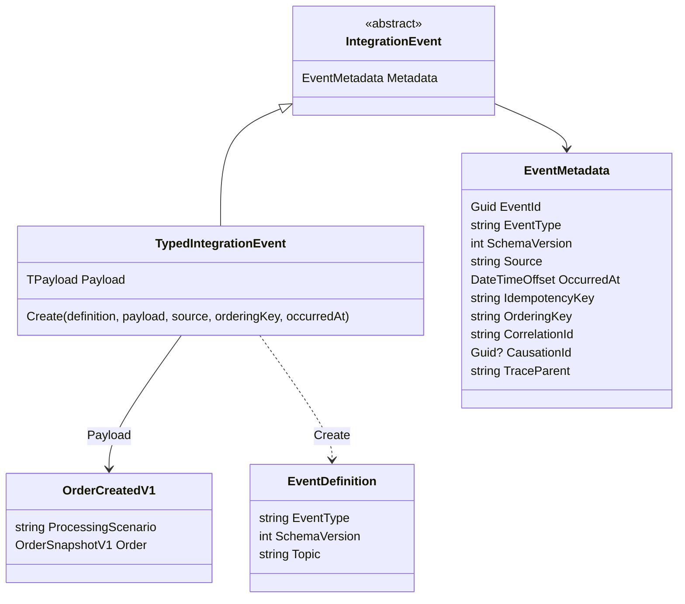
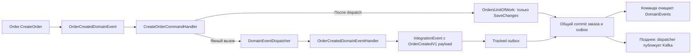
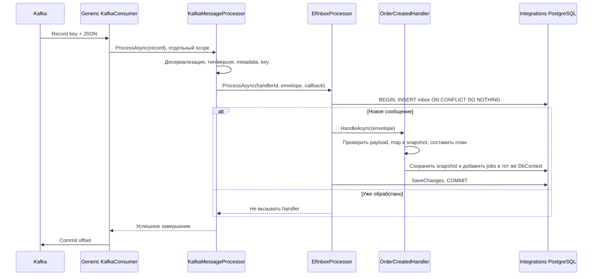

# Общие события, Kafka и transactional outbox/inbox

Реализация на 20.10.2026. Общая архитектура системы: [architecture.md](architecture.md).

## Библиотеки

```text
src/BuildingBlocks/
  Shared.Messaging.Abstractions/
    Events/          # Конверт, metadata, определение и валидация события
    Processing/      # Контракты handler и inbox processor
    Publishing/      # Контракты outbox/transport, маршруты и параметры доставки
  Shared.Messaging.Kafka/
    Configuration/   # Настройки подключения и подписок
    Consumers/       # Consumer, обработка записи, KafkaRecord и DLQ message
    Producers/       # Публикация через Kafka transport
    Serialization/   # JSON и чтение legacy-сообщений
    Topics/          # Инициализация topics
    DependencyInjection.cs
  Shared.Messaging.Persistence/
    Configuration/   # EF-модель общих таблиц
    Inbox/           # InboxMessage и транзакционная обработка
    Outbox/          # OutboxMessage, постановка и фоновая публикация
    Serialization/   # Общие JSON-настройки хранилища
    DependencyInjection.cs
```

Папки группируют файлы по ответственности. Публичные namespaces сохранены, поэтому
перемещение не требует изменения using и не меняет имена EF-сущностей в миграциях.

Application зависит от Abstractions (в текущих сервисах также транзитивно через Contracts).
Infrastructure подключает Kafka и Persistence. Никаких ссылок между сервисами не добавляется.
Persistence использует PostgreSQL: FOR UPDATE SKIP LOCKED, ON CONFLICT, jsonb. Это не универсальный
провайдер для любой СУБД. DbContext и миграции каждой БД по-прежнему принадлежат её сервису.

## Модель события



В C# конверт называется `IntegrationEvent<TPayload>`. Конкретный `OrderCreatedV1` — только payload:

```csharp
public sealed record OrderCreatedV1(
    string ProcessingScenario,
    OrderSnapshotV1 Order);
```

Общие поля не повторяются в каждом payload. Определение контракта отдельно задаёт его тип,
версию и default topic:

```csharp
public static EventDefinition<OrderCreatedV1> Definition { get; } =
    new("order.created.v1", 1, "orderbridge.orders.created.v1");
```

| Поле | Значение |
|---|---|
| EventId | Идентичность одного события; сохраняется при всех попытках доставки |
| EventType | Стабильное имя wire-контракта, не имя CLR-класса |
| SchemaVersion | Версия payload; consumer принимает зарегистрированную версию |
| Source | Сервис-источник; сейчас `orders` |
| OccurredAt | Когда возникло событие, а не время каждого retry |
| IdempotencyKey | Идентичность прикладного события, даже если его переупаковали с новым EventId |
| OrderingKey | Kafka record key; сейчас OrderId без дефисов |
| CorrelationId | Идентификатор цепочки; по умолчанию EventId без дефисов, можно передать свой |
| CausationId | EventId события-причины, если текущее событие возникло при его обработке |
| TraceParent | Activity.Id отправителя; consumer восстанавливает родительский W3C context |

Для OrderCreated ключ идемпотентности — `order.created:{orderId:N}`. Он отличается от
IdempotencyKey конкретной OrderIntegration: один идентифицирует событие создания заказа,
второй — внешнюю операцию. Счётчики публикаций, ошибки и время следующей попытки в metadata
не попадают: это изменяемое состояние outbox-записи.

Topic — деталь маршрутизации в EventDefinition и outbox, он не дублируется в payload.
Переопределение topic при регистрации Publish применяется к новым outbox-записям.
Уже поставленные в outbox сообщения сохраняют записанный маршрут.

**OrderingKey не означает глобальную строгую последовательность выполнения.** Он выбирает
partition. При нескольких событиях одного заказа задержанный outbox retry может позволить
позднему событию опередить раннее. Отложенный IntegrationWorker тоже не сортирует задачи
по бизнес-последовательности. Для строгих зависимостей потребуются версии/sequence и
прикладная проверка порядка; сейчас таких гарантий нет.

## Создание и публикация

Низкоуровневый пример постановки сообщения в outbox (для OrderCreated этот код
находится в Application-обработчике доменного события, не в command handler):

```csharp
var message = IntegrationEvent<OrderCreatedV1>.Create(
    OrderCreatedEvent.Definition,
    new OrderCreatedV1("FullCycle", snapshot),
    source: "orders",
    orderingKey: order.Id.ToString("N"),
    occurredAt: now,
    idempotencyKey: $"order.created:{order.Id:N}");

outbox.Add(OrderCreatedEvent.Definition, message);
// После завершения dispatcher команда вызывает IUnitOfWork.SaveChangesAsync.
```

`IEventOutbox.Add` не публикует в Kafka и не вызывает SaveChanges.
EfEventOutbox добавляет OutboxMessage в тот же scoped DbContext, что используется репозиторием.
Если нужно отложить публикацию, передайте третьим аргументом `new OutboxDeliveryOptions(notBefore)`.
Не следует заново создавать envelope при retry: сохраняются исходные metadata и payload.

Подключение к OrdersDbContext:

```csharp
public DbSet<OutboxMessage> OutboxMessages => Set<OutboxMessage>();

protected override void OnModelCreating(ModelBuilder builder)
{
    builder.ApplyConfigurationsFromAssembly(typeof(OrdersDbContext).Assembly);
    builder.AddOutbox();
}
```

Регистрация:

```csharp
services.AddEventOutbox<OrdersDbContext>();
services.AddKafkaMessaging(configuration.GetSection("Kafka"), kafka =>
    kafka.Publish(OrderCreatedEvent.Definition,
        configuration["Kafka:OrderCreatedTopic"]));
services.AddOutboxDispatcher<OrdersDbContext>();
```

Outbox dispatcher использует общий `IEventTransport`: topic и record key берутся из outbox,
а JSON отправляется без пересоздания сообщения. Подтверждение брокера предшествует PublishedAt.
Работают прежние `FOR UPDATE SKIP LOCKED`, максимум 20 сообщений за проход,
пауза прохода 2 секунды и повтор неудачной публикации через 10 секунд.
Внешние вызовы и публикация Kafka не входят в транзакцию PostgreSQL.

## От доменного факта к внешнему событию



Доменное событие и интеграционное сообщение имеют разные назначения:

- OrderCreatedDomainEvent принадлежит Orders.Domain и содержит снимок бизнес-факта.
  У него нет Kafka topic, Source, SchemaVersion и прочих транспортных полей.
- OrderCreatedV1 — внешний контракт в Contracts; common metadata находятся в IntegrationEvent.
- OrderCreatedDomainEventHandler в Application выполняет mapping и выбирает FullCycle.
  Он сохраняет EventId и OccurredAt исходного факта в metadata сообщения.
- DomainEventNotification<T> адаптирует чистый IDomainEvent к MediatR, не добавляя MediatR в Domain.
  Подписка — обычный INotificationHandler<DomainEventNotification<OrderCreatedDomainEvent>>,
  зарегистрированный сканированием Application assembly.

Команда создания явно организует все шаги:

```csharp
orderRepository.Add(order);

foreach (var domainEvent in order.DomainEvents)
{
    await domainEventDispatcher.DispatchAsync(domainEvent, cancellationToken);
}

await unitOfWork.SaveChangesAsync(cancellationToken);
order.ClearDomainEvents();
```

OrdersUnitOfWork только вызывает OrdersDbContext.SaveChangesAsync. Он не знает о dispatcher,
не сканирует агрегаты и не очищает DomainEvents. Другие сценарии изменения агрегатов должны
сами явно обработать нужные доменные события. Обычный SaveChanges не создаёт outbox автоматически.

Постановка сообщения в outbox происходит до SaveChanges в том же scoped DbContext, поэтому
заказ и outbox по-прежнему записываются одной EF-транзакцией. При ошибке dispatcher команда
до сохранения не доходит; при ошибке БД заказ и outbox откатываются вместе. В обоих случаях
DomainEvents не очищаются. После ошибки сценарий завершается и его DI scope освобождается;
автоматического повторного запуска обработчиков в том же контексте нет.

Обработчики доменных событий на этой фазе только меняют локальное tracked-состояние:
без внешних HTTP-вызовов, прямой Kafka-публикации и собственного SaveChanges.
Явный цикл относится к событиям данного заказа; автоматического рекурсивного обхода новых
событий всех агрегатов нет. Если обработка начинает порождать цепочки новых событий,
это должно быть явно организовано отдельным прикладным сценарием.

Чтение/материализация из EF не вызывает Order.CreateOrder и не поднимает событие заново.
Повторный SaveChanges не запускает handlers и не создаёт дополнительную outbox-запись.

Доменные события не являются event sourcing и не все должны становиться межсервисными сообщениями.
Для существующих OrderCancelledEvent и PaidCancelledOrderEvent внешние проекции пока не определены.
Никакие новые Kafka topics для них автоматически не создаются. Изменения схемы БД для этой
цепочки OrderCreated не потребовались.

## Приём и inbox

Обработчик в Application:

```csharp
public sealed class OrderCreatedHandler(
    IIntegrationPlanningStore store,
    IOrderIntegrationPlanner planner)
    : IEventHandler<OrderCreatedV1>
{
    public Task HandleAsync(
        IntegrationEvent<OrderCreatedV1> message,
        CancellationToken cancellationToken)
    {
        // Сокращённый пример: полный handler также проверяет payload и ordering key.
        var scenario = Enum.Parse<OrderProcessingScenario>(message.Payload.ProcessingScenario);
        var snapshot = OrderExecutionSnapshot.FromEvent(message.Payload.Order);
        var jobs = planner.Create(snapshot.Id, scenario, message.Metadata.OccurredAt);
        return store.SaveAsync(snapshot, jobs, cancellationToken);
    }
}
```

Полный handler использует ReadScenario с явной валидацией; пример показывает границу
ответственности и не заменяет его проверок.

Регистрация в Infrastructure/API:

```csharp
services.AddEventInbox<IntegrationsDbContext>();
services.AddKafkaMessaging(configuration.GetSection("Kafka"), kafka =>
    kafka.Subscribe<OrderCreatedV1, OrderCreatedHandler>(new KafkaSubscription<OrderCreatedV1>
    {
        Definition = OrderCreatedEvent.Definition,
        Topic = configuration["Kafka:OrderCreatedTopic"] ?? OrderCreatedEvent.Definition.Topic,
        GroupId = configuration["Kafka:ConsumerGroup"] ?? "orderbridge-integration-planner-v1",
        HandlerId = "order-created-integration-planner-v1",
        DeadLetterTopic = "orderbridge.orders.created.v1.dlq",
        LegacyReader = OrderCreatedEvent.ReadLegacy
    }));
```

DbContext подключает `builder.AddInbox()` и `DbSet<InboxMessage>`.
Свою модель `IntegrationOrder` он конфигурирует самостоятельно.



Общий inbox проверяет обе уникальности:

- `(Consumer, EventId)`;
- `(Consumer, Source, EventType, IdempotencyKey)`.

HandlerId — стабильное имя прикладного обработчика, а GroupId — Kafka consumer group.
При смене GroupId Kafka может перечитать старые события; стабильный HandlerId сохраняет
дедупликацию. Переименование HandlerId меняет область дедупликации и требует осознанной миграции.

Payload маппируется **внутри inbox-транзакции**, после успешной вставки новой receipt.
Если handler или SaveChanges падает, receipt и бизнес-данные откатываются вместе.
Полный конверт сохраняется в InboxMessages.Payload только у успешно принятых новых сообщений.

Это transactional inbox, а не отдельно коммитимая входная очередь с собственным worker.
Не вызывайте из такого handler внешние HTTP API и не открывайте вложенную независимую транзакцию.
Планируйте внешнюю работу в локальной БД; именно так работает Integrations.

## Ошибки и ограничения

| Случай | Поведение |
|---|---|
| Неверный JSON, metadata, тип/версия, record key | InvalidEventException → DLQ → commit offset |
| Явно неверный бизнес-payload | Handler бросает InvalidEventException; rollback inbox → DLQ → commit offset |
| Ошибка БД/неожиданное исключение | Не подтверждать offset, переподключиться и повторить |
| Ошибка публикации DLQ | Не подтверждать исходный offset |
| Повтор того же события или idempotency key | Не вызывать handler повторно; подтвердить offset |

У consumer выключены auto commit и auto offset store. Он обрабатывает сообщения последовательно,
по одному на свою подписку; разные subscriptions работают в отдельных hosted services.
Пока поддерживается одна подписка на TPayload на процесс; повторная регистрация запрещена.
Разным самостоятельным подписчикам нужны разные GroupId, репликам одного подписчика — одинаковый.

Нет безусловного «exactly once»: публикация и offset commit всё ещё могут повторяться при сбоях.
Дедупликация относится к транзакционным локальным изменениям, а не к произвольным внешним API.
DLQ replay, inbox replay, строгая глобальная последовательность и восстановление зависших
OrderIntegration.Processing этим рефакторингом не добавляются.

Topic initializer создаёт topics для локальной демонстрации: 3 partitions, RF=1, retention 7 дней.
Он не меняет конфигурацию уже созданных topics. В production provisioning следует вынести в deployment.
TraceParent переносится в envelope до consumer, но до отложенного integration worker непрерывная
трасса пока не продолжается. OTel exporter не подключён.

## Старые сообщения и миграции

Миграции `SharedMessagingEnvelope` в обеих БД применяются после существующих initial migrations:

- Orders переводит сохранённый legacy payload в envelope, сохраняя Id/EventId, даты,
  PublishAttempts, PublishedAt и ошибки. Вместо специфичного OrderId появляются Topic,
  OrderingKey и IdempotencyKey.
- Integrations сохраняет старые PK receipts и заполняет метаданные для дедупликации.
  У исторических receipts Payload остаётся null: исходный JSON невозможно восстановить из старой БД.
- LegacyReader в Contracts принимает старый формат из Kafka и создаёт envelope с тем же EventId.
  Поддержка legacy не зашита в общую Kafka-библиотеку.
- Для старых событий IdempotencyKey равен EventId без дефисов. Для новых OrderCreated используется
  семантический ключ заказа. Существующая уникальность плана сохраняет дополнительную защиту.
- Скрипт Import-LegacyDatabase.ps1 тоже переводит старые outbox/inbox в новые схемы.

Безопасный порядок обновления существующей установки: остановить оба старых API-процесса,
обновить схемы и образы, запустить новый consumer и producer. LegacyReader обеспечивает чтение
старого формата новым consumer; обратная совместимость старого consumer с новым envelope не заявляется.
Не удаляйте volumes и не переписывайте initial migrations для такого обновления.

## Как добавить следующее событие

1. Создать payload и EventDefinition в Contracts. Не добавлять общие metadata-поля в payload.
2. Если событие отражает доменный факт, поднять его из агрегата и в Application-handler
   преобразовать в IntegrationEvent, добавив через IEventOutbox в транзакцию UnitOfWork.
3. Зарегистрировать Publish и outbox dispatcher у отправителя.
4. У получателя реализовать IEventHandler<TPayload> и зарегистрировать Subscribe.
5. Подключить inbox к его DbContext и создать миграцию, если сервис ещё не использует inbox.
6. Проверить повтор одного EventId, новый EventId с прежним idempotency key и rollback обработки.

Producer/consumer loops, JSON, DI scopes, offset commits и DLQ для нового события писать заново не нужно.
